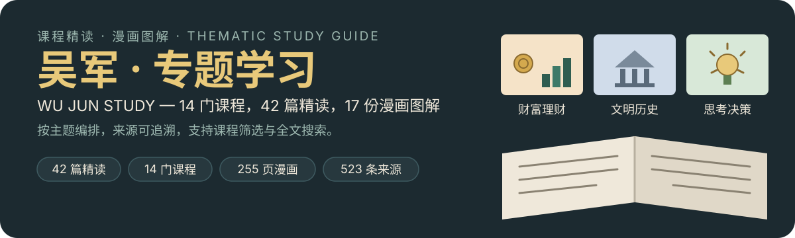
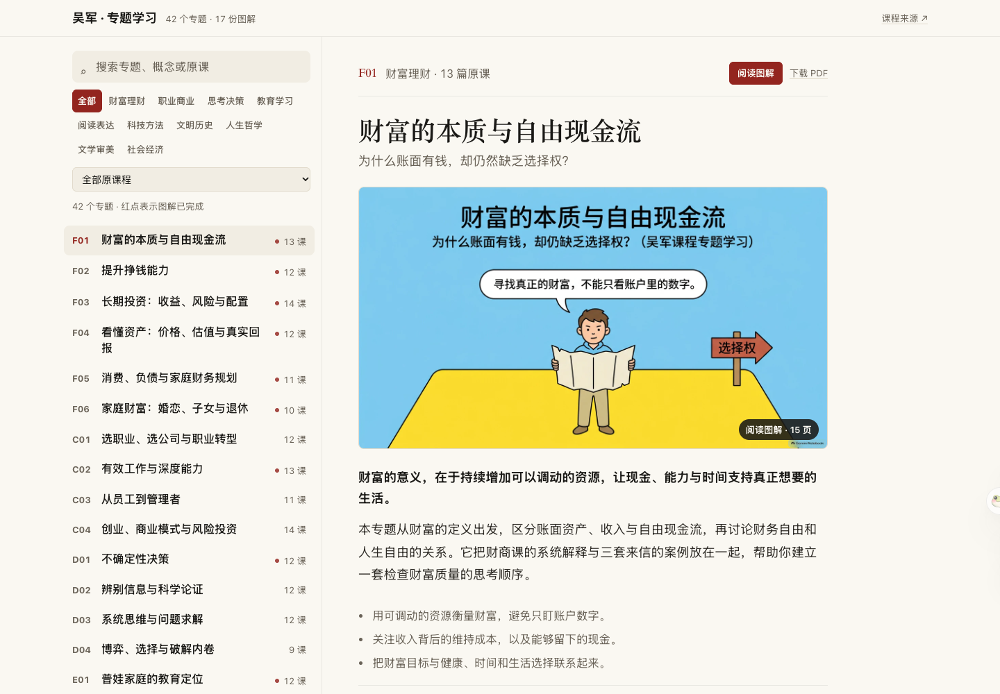
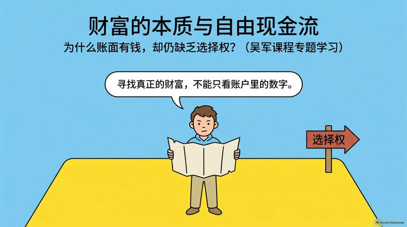

<p align="right"><a href="README.md">中文</a></p>

<p align="center">
  
</p>

<p align="center">
  <a href="https://wujun-study.xiaosang.cc/">▶ Read Online</a>
  ·
  <a href="https://github.com/holynova/wujun-study">GitHub Repository</a>
</p>

Wu Jun Study is a thematic study guide to 14 Wu Jun courses, organized into 42 study articles: each one centers on a key question, distills the core concepts, and cites traceable course sources (523 references in total). It also includes 17 Chinese clear-line comic slide decks, 15 pages each (255 pages), with a fullscreen reader and PDF downloads. Responsive two-column reading layout, mobile-friendly.

## Screenshots

<p align="center">
  
  
</p>

## 42 Articles · 10 Themes

| Theme | Articles | Topics |
|------|------|------|
| 财富理财 (Personal Finance) | 6 | The Nature of Wealth and Free Cash Flow, Raising Your Earning Power, Long-Term Investing, Understanding Assets, Consumption and Household Financial Planning, Family Wealth |
| 文明历史 (Civilization & History) | 6 | Origins of Civilization, the Axial Age and Greece–Rome, Transformation of Chinese Civilization, Medieval Exchange and Reconstruction, Renaissance and the Modern Order, the Age of Discovery and the Industrial Revolution |
| 教育学习 (Education & Learning) | 5 | Education Positioning for Ordinary Families, Building Children's Abilities by Stage, Choosing a University and Major, Systematic and Lifelong Learning, Education Systems and General Education |
| 科技方法 (Technology & Methods) | 5 | The Twin Threads of Energy and Information, From Invention to Innovation, Computational Thinking, the Trajectory of AI, 5G Communications and Technology Judgment |
| 职业商业 (Career & Business) | 4 | Choosing a Career and Changing Course, Effective Work and Deep Ability, From Employee to Manager, Entrepreneurship and Business Models |
| 思考决策 (Thinking & Decision-Making) | 4 | Decisions Under Uncertainty, Telling Information from Noise and Scientific Argument, Systems Thinking, Game Theory and Escaping Involution |
| 人生哲学 (Philosophy of Life) | 4 | Adversity and Self-Reconciliation, Long-Termism, Family Relationships and Boundaries, Freedom and Happiness |
| 阅读表达 (Reading & Expression) | 3 | Reading Comprehension and Close-Reading Methods, Practical Writing, Speaking and Effective Communication |
| 文学审美 (Literature & Aesthetics) | 3 | Human Nature and Choice in Literature, Literature, Society and Culture, Understanding Painting and Aesthetics |
| 社会经济 (Society & Economics) | 2 | Scarcity, Pricing and Resource Allocation, Globalization, Demographics and Social Change |

14 courses: 硅谷来信系列 (Letters from Silicon Valley series — 硅谷来信, 硅谷来信 2·谷歌方法论, 硅谷来信 3), 吴军来信 1·世界文明史 (Wu Jun's Letters 1: A History of World Civilization), 吴军来信 2 (Wu Jun's Letters 2), 财商训练 40 讲 (40 Lessons on Financial Literacy), 数学通识 50 讲 (50 Lectures on General Mathematics), 信息论 40 讲 (40 Lectures on Information Theory), 科技史纲 60 讲 (60 Lectures on the History of Technology), 教育的方法 50 讲 (50 Lectures on the Methods of Education), 逻辑思维训练 50 讲 (50 Lectures on Logical Thinking), 阅读与写作 50 讲 (50 Lectures on Reading and Writing), 吴军讲 5G (Wu Jun on 5G), 关键时刻行动手册 (Action Manual for Critical Moments).

## Comic Decks

- **17 decks complete**: 15 pages each, 255 pages in total; all six personal-finance topics are complete.
- **Fullscreen reader + PDF downloads**: every deck has a matching PDF (e.g. `public/slides/ep-1.pdf`).
- **25 decks pending**: sources and outlines are ready; generation is paused due to NotebookLM rate limits.

## How to Use

- **Browse by theme**: 42 articles across 10 themes, filterable by course.
- **Full-text search**: the search box covers all articles (index at `public/search.json`).
- **Trace sources**: every article lists the courses it cites and how many references each contributes; click through to see the source.

## Run Locally

```sh
npm ci
npm run dev
```

Verify and build:

```sh
npm test        # node scripts/verify.mjs
npm run build   # vite build + release write
```

## Tech

- Vite 6 + vanilla JavaScript (no framework), two-column reading layout, mobile-friendly.
- Data-driven: each of the 42 articles is one JSON file (`src/data/topics/`, with question, concepts, courses, and sources), indexed in `src/data/index.json`; comic pages are WebP (`public/static/`, 17 sets × 15 pages), PDFs in `public/slides/`.

```
index.html              Entry point
src/main.js             App entry: routing, search, filters
src/render.js           Article rendering and comic reader
src/data/index.json     Index of 42 articles (theme / question / concepts / courses / source count)
src/data/topics/        42 article JSON files
src/data/slides.json    Index of 17 comic decks (page count / PDF URL)
public/search.json      Full-text search index
public/static/          Comic pages as WebP (17 sets × 15 pages)
public/slides/          17 deck PDFs
scripts/                Comic pipeline (generate / review / package / verify)
docs/production.md      Production workflow notes
```

## Disclaimer

A selective thematic study guide, not a complete transcription of the original courses. Original course content, accounts, and production status are not part of the public output.
