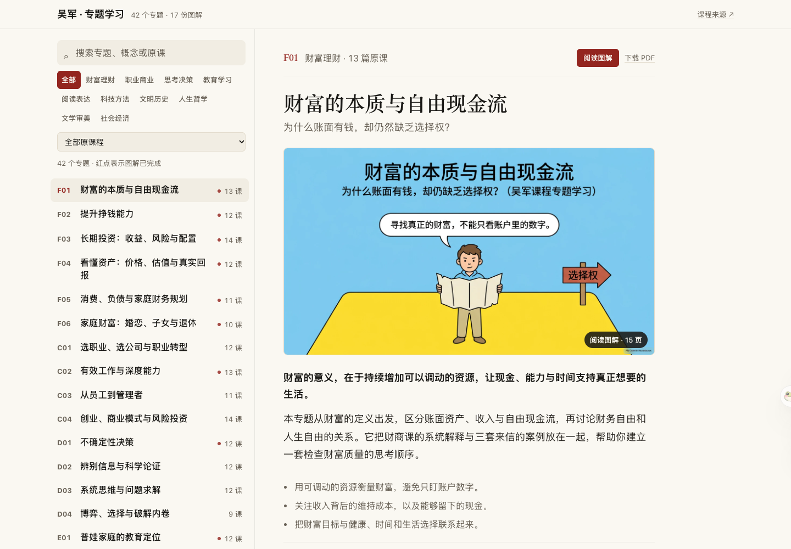

<p align="right"><a href="README.en.md">English</a></p>

<p align="center">
  
</p>

<p align="center">
  <a href="https://wujun-study.xiaosang.cc/">▶ 在线阅读</a>
  ·
  <a href="https://github.com/holynova/wujun-study">GitHub 仓库</a>
</p>

吴军 · 专题学习把吴军 14 门课程按主题编排为 42 篇精读文章：每篇围绕一个核心问题展开，提炼关键概念，并附可追溯的课程出处（共 523 条来源）。另有 17 份中文清线漫画图解，每份 15 页、共 255 页，支持全屏阅读和 PDF 下载。双栏阅读布局，适配手机。

## 截图

<p align="center">
  
  
</p>

## 42 篇精读 · 10 个主题

| 主题 | 篇数 | 专题 |
|------|------|------|
| 财富理财 | 6 | 财富的本质与自由现金流、提升挣钱能力、长期投资、看懂资产、消费与家庭财务规划、家庭财富 |
| 文明历史 | 6 | 文明起源、轴心时代与希腊罗马、中华文明转型、中世纪交流与重建、文艺复兴与现代秩序、大航海与工业革命 |
| 教育学习 | 5 | 普娃家庭的教育定位、孩子各阶段能力培养、选大学与专业、系统学习与终身成长、教育制度与通识 |
| 科技方法 | 5 | 能量与信息的双主线、发明到创新、计算机思维、AI 发展脉络、通信 5G 与技术判断 |
| 职业商业 | 4 | 选职业与转型、有效工作与深度能力、从员工到管理者、创业与商业模式 |
| 思考决策 | 4 | 不确定性决策、辨别信息与科学论证、系统思维、博弈与破解内卷 |
| 人生哲学 | 4 | 困境与自我和解、长期主义、家庭关系与边界、自由与幸福 |
| 阅读表达 | 3 | 阅读理解与精读方法、实用写作、口头表达与有效沟通 |
| 文学审美 | 3 | 文学中的人性与选择、文学与社会文化、看懂绘画与审美 |
| 社会经济 | 2 | 稀缺、定价与资源配置、全球化、人口与社会变迁 |

14 门课程：硅谷来信系列（硅谷来信、硅谷来信 2·谷歌方法论、硅谷来信 3）、吴军来信 1·世界文明史、吴军来信 2、财商训练 40 讲、数学通识 50 讲、信息论 40 讲、科技史纲 60 讲、教育的方法 50 讲、逻辑思维训练 50 讲、阅读与写作 50 讲、吴军讲 5G、关键时刻行动手册。

## 漫画图解

- **17 份已完成**：每份 15 页，共 255 页；理财 6 个专题全部完成。
- **全屏阅读 + PDF 下载**：每份图解都有对应的 PDF（如 `public/slides/ep-1.pdf`）。
- **其余 25 份待生成**：来源与提纲已备好，受 NotebookLM 限流影响暂未完成。

## 使用方式

- **按主题浏览**：42 篇精读按 10 个主题分类，可按课程筛选。
- **全文搜索**：搜索框检索全部精读内容（索引见 `public/search.json`）。
- **来源追溯**：每篇精读标注引用的课程与来源条数，点击可查看出处。

## 本地运行

```sh
npm ci
npm run dev
```

校验与构建：

```sh
npm test        # node scripts/verify.mjs
npm run build   # vite build + release 写入
```

## 技术

- Vite 6 + 原生 JS（无框架），双栏阅读布局，移动端适配。
- 数据驱动：42 篇精读各为一个 JSON（`src/data/topics/`，含问题、概念、课程、来源），索引在 `src/data/index.json`；漫画页为 WebP（`public/static/`，17 组 × 15 页），PDF 在 `public/slides/`。

```
index.html              入口
src/main.js             应用入口：路由、搜索、筛选
src/render.js           精读渲染与漫画阅读器
src/data/index.json     42 篇索引（主题 / 问题 / 概念 / 课程 / 来源数）
src/data/topics/        42 篇精读 JSON
src/data/slides.json    17 份图解索引（页数 / PDF 地址）
public/search.json      全文搜索索引
public/static/          漫画页 WebP（17 组 × 15 页）
public/slides/          17 份图解 PDF
scripts/                漫画管线（生成 / 审核 / 打包 / 校验）
docs/production.md      生产流程说明
```

## 声明

本项目为选择性主题编排的学习笔记，不代表覆盖全部原课内容；原始课程、账号与生产状态不进入公开产物。
